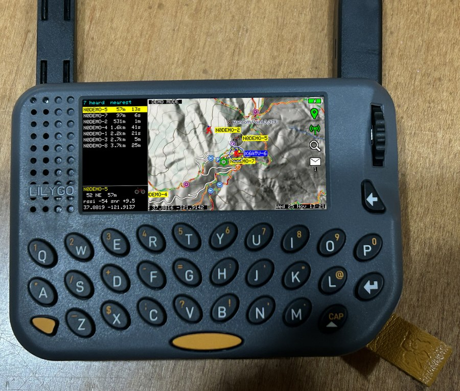
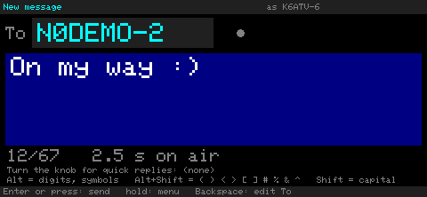

# lora-aprs-pager

A LoRa APRS tracker, station map and messenger for the **LilyGO T-LoRa Pager (433 MHz)**, written from scratch.
It listens on 433.775 MHz, draws the stations it hears on a map from your own SD card, beacons your position, and sends and receives
APRS messages with acknowledgements, all on the pager's own screen, rotary knob and keyboard. Setup is done from a phone.

> **Status: working, and in active development.** Offline maps, heard stations, beaconing, two-way messaging, following your own position and
> low-power operation with the screen off, and more, have been tested on a LilyGO T-LoRa Pager. So far that is one unit (the SX1262
> version). Still being tested: motion wake while driving, following a station that is moving, and battery runs longer than a day. We are still looking
> for ways to reduce power ([notes](docs/low-power.md)).
> **It transmits.** You need an amateur radio licence and your own call sign. The pager will not transmit until a call sign is saved.

*Illustration: a photo of the pager with a demo screen (simulated stations) and status icons placed into it, including the unread-message envelope.*

*The screenshots with stations and with the full list show **demo data**: simulated stations (`N0DEMO-1` to `-8`) around the summit of Mount Diablo, produced by the
firmware's demo mode (`DEMO MODE` is shown on the screen, and nothing is transmitted while it is on). The other screenshots are real.*

## What it does

- **Map.** Reads the standard `<z>/<x>/<y>.png|jpg` raster tile layout from the SD card (the same layout the T-Deck LoRa APRS
  firmware uses, so one card works in both). Knob to pan and zoom, GPS position, centre on me. Decoded tiles are cached in PSRAM.
- **Heard stations.** Decodes LoRa APRS position packets (plain and compressed positions, objects), draws each station with its
  APRS symbol (24 px, including overlay letters), and keeps a list. Icons that would overlap are fanned out with a line to the true
  position, and the labels are stacked so none covers another. Your own symbol and call sign are drawn too.
- **Four views on the L key**, named as you switch: `LIST+MAP`, `MAP+STATIONS`, `MAP ONLY`, `FULL LIST`. The full list shows, for each
  station, how long ago it was heard, how many packets, whether it came directly or through a digipeater (and which), the path, RSSI and
  SNR, position, distance and bearing from you, its comment, and the complete packet text.
- **Status icons** down the right edge of the map, under the battery: GPS fix (green) or not (grey); the antenna, green with auto-beacon on and
  grey with it off, **red** while transmitting and **purple** for 2 s after a packet is received; what the knob does (for 5 s after a press);
  an envelope with the number of unread messages; a padlock while the screen is kept on. The top line is only used for passing notices.
- **Repeaters that hear you.** When a digipeater repeats one of your packets and the path shows which one, the pager says so and lists it with
  its signal and when it was heard. It has no map position until the pager hears the digipeater's own position.
- **Beacon.** Sends your position with your chosen symbol and comment. Listens first (channel activity detection) and skips the beacon if
  the channel is busy. Auto-beaconing is **off at power-on** unless you switch that on in setup; moving it beacons about once a minute
  after 200 m, standing still every 10 minutes (all settable).
- **Messaging** (design in [docs/messaging.md](docs/messaging.md)). Conversations per call sign with unread badges, threads, compose with
  quick replies on the knob, acks and retries (30 s, then doubling, six tries), one open message per addressee, delete with undo,
  ASCII emoticons drawn as pictures on the screen (the text on the air stays plain ASCII), RSSI and SNR on received messages.
  Messages are kept in the pager's flash.
- **Setup from a phone.** Press Enter: the pager opens its own WiFi hotspot (random password, QR code on the screen) and serves a
  setup page at `http://192.168.4.1`: call sign, symbol (with a picker), comment, path, power, beacon intervals, haptics, brightness, screen timeout, time zone, the battery shape and how the GPS sleeps while the screen is off.
  The hotspot is off again when you leave the screen.
- **Clock and battery.** Date and time at the bottom right of the map, from GPS time (kept in the pager's RTC chip, so it is also right at power-on
  without a fix); set your time zone as hours from UTC (California is -8) and tick the box to add an hour in US daylight saving time. An optional
  battery shape in the top right corner shows the charge in green (yellow below 30 %, red below 15 %) and a `+` while charging.
- **Screen timeout.** The screen dims, then the backlight goes off (both times are settable, or never). There is no lock screen: any key or knob turn
  wakes it at once, showing what was there. After the backlight was fully off, that first touch only wakes it. A new message also wakes it.
- **Low power with the screen off.** The processor light-sleeps between events and still hears every packet; the SD card and the display panel are
  powered down; the GPS sleeps and wakes now and then for a fix, **adaptively**: every minute while you are moving, and every few minutes once two fixes in a row
  show you have not moved (or it cannot see the sky). Both times, and an off switch, are in the phone setup ("Battery, screen off"). With **motion wake** (off by default, a checkbox in the phone setup) the motion sensor cuts the long GPS sleep short when you start moving
  (tested walking, not yet driving). A beacon sent while
  the screen is off uses the last fix, so it can be a little old. Measured on one pager with a power analyser: it **sleeps at about 19.5 mA** with the screen off and the radio receiving (about 65 mA before the power work, read from the fuel gauge); GPS searches add to that (see [Battery life](#battery-life)). Two options, off by default and still being tested, reduce it further. USB disables
  the sleep, so the serial port stays up.
- **Help screen.** Backspace, then **Help**: the keys and knob actions, and a QR code for the map SD card guide (turn the knob for the second page).
- **Mic-E** position packets (used by many handheld and mobile radios) are decoded, including blanked-digit position ambiguity; checked against
  301 real packets with an independent decoder.
- **Haptic feedback** on knob clicks, new messages, acks and errors.
- **Screenshots over USB** for documentation (`tools/screenshot.py`). The firmware also answers a few one-letter test commands on USB serial
  (`S` screenshot, `M` open Messages, `G<lat>,<lon>,<zoom>` map position, `V<0-3>` station view, `C<call>` select a station, `X` close menus,
  `D<lat>,<lon>` demo mode with simulated stations (never transmits), `B` read the battery gauge, `R` restart), and `P...` commands for power
  testing (see [docs/low-power.md](docs/low-power.md)). Send them only from your own computer.

The firmware only **reads** the SD card. Settings and messages live in the pager's own flash.

| | |
|---|---|
|  |  |
| FULL LIST view (demo data): everything about the selected station | A station that has just been heard lights up (demo data) |
|  |  |
| MAP+STATIONS view (demo data) | Terrain, grade-coloured trails and peak heights from your own map card |
|  |  |
| Writing a message: the call sign and the text (`:)` typed with Alt+Shift) | Message list |
|  | |
| Phone setup: scan the left code to join the pager's hotspot, the right one to open the page | |

## Controls

The rotary knob works everywhere on its own; the keyboard types text and gives shortcuts.

**Map**

| | |
|---|---|
| Knob turn / short press | move or zoom / change what turning does (pan W-E, pan N-S, stations, zoom) |
| Knob long press | centre the map on my GPS position |
| `L` | next view: LIST+MAP, MAP+STATIONS, MAP ONLY, FULL LIST |
| `S` | station list order: nearest first / most recent first |
| `M` | messages |
| `C` | centre on me |
| `T` | auto-beacon on / off (off at every power-on unless set in setup) |
| `B` | send one beacon now |
| `Backspace` | main menu: messages, phone setup, beacon now, auto-beacon, help, power off |
| `Enter` | phone setup |
| `P` | send a screenshot over USB (with `tools/screenshot.py`) |

**Following:** like a car navigator, the map follows your own position once there is a GPS fix. Panning or scrolling pauses it for 15 seconds;
zooming does not. To follow a moving station instead (a balloon, another vehicle), select it in the list and choose "Follow <station>" in the
Backspace menu; the top row then shows its distance and bearing from you and how long ago it was heard. It moves only when a new position from it is
heard. The same menu goes back to following you.

**Restart history** (Backspace menu, "Help, restart history", third page): the last ten starts with their time, reason (crashes in red) and how
long the run before lasted, plus totals. It is kept in flash, so the RST button and a flat battery do not erase it. This chip reports the RST
button and a power-on the same way.

**Keep screen on** (Backspace menu; the confirmation starts on "No"): the screen does not dim or switch off, which uses much more battery, and a
padlock shows on the map. It is a separate choice from what the map follows, and is always off after a restart.

**Main menu** (Backspace on the map): turn = move, press = choose, long press or Backspace = close.

**Full list view:** turn = select a station, press = write a message to it, long press = show it on the map.
**Messages:** `N` new message, turn = move, press = open / reply / send, long press = menu (reply, cancel retries, delete message,
delete conversation, delete all, undo), `Backspace` = back, `M` = back to the map. Typing: hold `Alt` = digits and symbols (`* / + - = : ' " @ _ $ ; ? ! , .`), hold `Alt` and `Shift` together = `( ) < > [ ] \ # % & ^` and the back quote
(so emoticons like `:)` and `<3` can be typed), tap `Shift` = the next letter is a capital.

## Before you transmit

This firmware **transmits** on 433.775 MHz (the LoRa APRS frequency) at up to 22 dBm. It is for **licensed amateur radio operators only**:
- Use your own call sign. The pager will not transmit until you save one (it ships as `N0CALL`).
- 433.775 MHz is hard-coded. Check that your licence and your country's band plan allow LoRa APRS on that frequency and at the power you set.
- It beacons your **GPS position publicly**: anyone on the network can see where you are. Auto-beacon is off at every power-on unless you switch it on.
- Messages are plain text. **Encryption is not allowed on amateur radio**, so none is offered.
- You are responsible for your transmissions: check your local rules before use.

## Power

- **Turn off:** Backspace, choose **Power off**, then **Yes, power off** (the menu starts on No). The pager stops the beacon, saves your
  messages, puts the radio to sleep and tells the battery charger chip (BQ25896) to disconnect the battery. It **refuses while USB is
  connected** ("Unplug USB first"): that is the chip's own rule. Tested on the author's pager: it switched off.
- **Turn on:** hold the **POWER** button for about a second (bottom edge: RST, BOOT, **POWER**, SD socket, USB-C), or plug in USB.
  It starts like any power-on: your settings and messages are kept, auto-beacon is off unless you set it to start on.
- RST restarts the application; BOOT with RST is download mode for flashing (see below). Neither switches the pager off.

### Battery life

**Estimates** for the 1500 mAh cell with the pager **still, screen off, listening, and a beacon every 10 minutes** (SF12). The currents were
measured on one pager with a power analyser; the days are calculated from them. A full run down of the battery has not been timed.

| Settings | Sleep current (measured) | Average, GPS searching 6% of the time | Days | Average, searching 20% | Days |
|---|---|---|---|---|---|
| Before the power work (fuel gauge) | | about 65 mA | about 1 | | |
| Normal (the default) | 19.5 mA | about 22 mA | **2.4 to 2.9** | about 26 mA | 2.0 to 2.4 |
| Both power options on | **10.9 mA** | about 13 mA | **4 to 4.7** | about 17 mA | 3.1 to 3.7 |

"Days" runs from 85% of the rated capacity to all of it. **How often the GPS searches, and for how long, depends on reception.** About 6% is what
a 13 hour battery run by a window showed in its last 8 hours; 20% is about what the analyser runs showed.

The two options are in the phone setup, **off by default and still being tested**:

| Option | What was measured | Still to check |
|---|---|---|
| Switch GPS power off between searches | sleep 11.9 mA instead of 19.5 | moving, without motion wake |
| Slower processor (40 MHz) while the screen is off | GPS searches about 38 mA instead of 51 | moving, more places and reception |

The 10.9 mA reading has both on, and the haptic driver off between buzzes (the firmware now always does that; it was not part of the 19.5 mA
reading). In the 13 hour battery run with both on there were no restarts or crashes and 95% of GPS searches got a fix. Moving, using the screen,
messages, weak reception, cold and battery age all shorten these times. With the screen on the pager draws about 70 mA dimmed and 96 mA bright
(read during start-up).

To save power now: let the screen time out (shorter is better), keep USB unplugged, lower the brightness, beacon less often, and use
**Power off** (Backspace) when it will not be used for days. What was measured and how, including leaks that cost about 40 mA and how to avoid
them in other firmware for this board, is in [docs/low-power.md](docs/low-power.md).

## Hardware

ESP32-S3, 16 MB flash, 8 MB QSPI PSRAM; ST7796 480x222 colour display; **SX1262** radio (the unit it was developed on; an LR1121 version
exists and the bring-up test probes both, but the application drives the SX1262 only); MIA-M10Q GPS; TCA8418 keyboard; rotary encoder; DRV2605 haptic driver; BQ27220 fuel gauge;
XL9555 I/O expander that switches power to the radio, GPS, keyboard and SD and **must be initialised before them**; one SPI bus shared by the
display, SD card, radio and NFC. Pins are in `src/pins.h` and match LilyGoLib's pager variant.

Things worth knowing (all found on the real hardware):
- Keyboard: the `P` key arrives as raw code 97 and `Enter` as 98 (the chip reports the last column as GPIO-style events), and `Enter` also
  closes matrix key 20. The map is in `src/keymap.h`. The keyboard chip has been seen to stop reporting keys; the firmware now checks its
  setup once a second and re-programs it (cause not proven, suspected radio burst).
- The screen's bytes are swapped for 16-bit pixels in LovyanGFX; icon blending in `src/app/app.cpp` accounts for that.
- Opening the pager's USB serial port with DTR/RTS set resets the chip every time. `tools/screenshot.py` does not set them.

## Build and flash

You need [PlatformIO](https://platformio.org/install) (the CLI or the VS Code extension), a LilyGO [T-LoRa Pager](https://lilygo.cc/) (433 MHz, SX1262) and a USB-C cable.
Defaults you may want to change: the clock shows **US Pacific time** (set your own offset on the phone setup page) and the map starts centred on the San Francisco Bay Area until it has a GPS fix.

    pio run -e app                          # the application
    pio run -e app -t upload --upload-port <PORT>

PlatformIO environments: `app` is the application, `pager` is the milestone-1 bring-up test,
`bench` / `bench_tdeck` are the read-only tile benchmarks (see [docs/benchmarks.md](docs/benchmarks.md)). The last three, and `src/bench/`, are
development builds you do not need to use the pager.

**Before the first flash, back up the factory firmware** (the LilyGO menu is replaced by this application):

    python -m esptool --chip esp32s3 --port <PORT> read_flash 0x0 0x1000000 pager-factory-16MB.bin

Restore with `write_flash 0x0 pager-factory-16MB.bin`. LilyGO also publishes factory images in
`Xinyuan-LilyGO/LilyGoLib/firmware`. **To flash, the pager must be in download mode:** hold BOOT, tap RST, release BOOT. After flashing,
press RST alone to start the new firmware.

**Flashing a release file instead of building** (see the Releases page). Put the pager in download mode first, then, with `esptool` installed:

    # first install (or to start clean): the complete image. This ERASES the saved settings (call sign and so on)
    esptool.py --chip esp32s3 --port <PORT> write_flash 0x0 lora-aprs-pager-v0.1.0-alpha.2-tlora-pager-sx1262.bin
    # update an already installed pager and keep its settings: only the application
    esptool.py --chip esp32s3 --port <PORT> write_flash 0x10000 lora-aprs-pager-v0.1.0-alpha.2-tlora-pager-sx1262-app-only.bin

First start: press Enter, join the pager's hotspot from your phone (scan the QR code), open `http://192.168.4.1` and save your call sign.
Until then the pager listens and shows the map but will not transmit.

## SD card

`/LoRa_Tracker/Maps/<REGION>/<z>/<x>/<y>.png` or `.jpg`, 256 px tiles on a FAT32 card (the T-Deck's 128 GB FAT32 card mounts
as SDHC and works). The first region folder found is used; zoom levels 6, 7, 8, 10, 12 and 14.
Any set of 256 px tiles in the standard `<z>/<x>/<y>` layout works: the tile packs made for the T-Deck LoRa APRS firmware, or tiles you render yourself
(for example from OpenStreetMap with a tile-rendering tool, respecting the map data's licence and attribution). This firmware only reads the card.

## Tests

The parsers and engines are plain C++ and are tested on a PC:

    for t in aprs geo settings messaging emoticons textedit clock ubx gpsduty rxduty; do
      c++ -std=c++17 -I src test/host/test_$t.cpp -o /tmp/test_$t && /tmp/test_$t; done

They cover the APRS frame parser and beacon builder, GPS sentences, the u-blox messages sent to the GPS, distance and bearing, the settings validation, the messaging engine
(including a message and its ack going through two engines), the emoticon matcher, and the keyboard map and text entry (key sequences with the real key numbers).

## Layout

| | |
|---|---|
| `src/app/app.cpp` | the application: map, stations, beacon, setup hotspot, glue |
| `src/aprs.h`, `src/nmea.h`, `src/geo.h`, `src/ubx.h`, `src/gpsduty.h`, `src/rxduty.h` | APRS frames, GPS sentences, distance / bearing, u-blox GPS messages, the GPS sleep interval, the receive burst timing (plain C++) |
| `src/messaging.h`, `src/msg_ui.h`, `src/emoticons.h` | messaging engine, its screens, emoticon matching |
| `src/settings_core.h`, `src/webui.h` | settings and their validation, the phone setup page |
| `src/beacon.h`, `src/haptic.h`, `src/inputs.h`, `src/keymap.h` | beacon timing, haptics, knob and keyboard |
| `src/symbols24.bin`, `src/emoji18.bin`, `src/web/` | icon data built by the scripts in `tools/` |
| `tools/` | icon builders, `screenshot.py`, `mockup/` (screenshot in a picture of the device), `count_vec.py` |
| `docs/messaging.md` | the messaging design and the reasoning behind it |
| `docs/benchmarks.md` | tile and vector measurements |
| `docs/low-power.md` | where the power goes on this board, what was measured, how to save energy |

## Not done yet

Other position formats (weather, telemetry and others) are not decoded; bulletins, group text and meeting-spot objects are
designed but not built; the LilyGO menu cannot be kept alongside this application (it needs a
two-app flash layout); the tocall is the experimental `APZPGR` (a registered one is to be requested); vector maps are a later phase.

## Releases

> **The latest release is older than the code here** and lacks several recent fixes (among them: the radio with the SD card switched off, the
> GPS wake-up, and message acknowledgements). To get those, build from source.

The latest release is **v0.1.0-alpha.2** (about 24 mA with the screen off instead of about 65 mA; the first was v0.1.0-alpha.1). Both are testing releases, meant for people who are comfortable building firmware and who hold an amateur radio licence.
Bug reports are welcome. Not done yet is listed above; the registered tocall (the pager currently transmits as the experimental `APZPGR`, see
`docs/tocall-request.md`) is one of the first things to change.

## Licence

The code is under the MIT licence (see `LICENSE`). The pictures and libraries below keep their own terms.

## Credits and licences of things in the firmware

These pictures are **not** covered by this project's own licence:
- **APRS symbols:** the aprs.fi symbol set by Heikki Hannikainen, OH7LZB (https://github.com/hessu/aprs-symbols), included here with this credit.
  Its licensing is mixed and partly unknown: most symbols are vectorised from the old APRS bitmaps whose designers and licence are unknown,
  some are CC BY-SA 2.0 or public domain, and a few are brand logos (Apple, Microsoft, Kenwood) that belong to those companies. Read its
  `COPYRIGHT.md`. If you are a rights holder and want a symbol removed, open an issue. Built into `src/symbols24.bin` and `src/web/sym*.png` by `tools/make_symbols.py` and `tools/make_symbol_sheets.py`.
- **Emoticon pictures:** Twemoji graphics, (c) Twitter, Inc and other contributors, CC-BY 4.0 (https://github.com/jdecked/twemoji,
  LICENSE-GRAPHICS), built into `src/emoji18.bin` by `tools/make_emoji.py`.

Libraries: LovyanGFX (display), RadioLib (radio), and the Arduino-ESP32 core; see each project for its licence. Pin numbers and the board's
start-up order were checked against LilyGO's LilyGoLib (MIT). The map tiles belong to whoever made them: credit them where they are shown.

## Prior art (searched 2026-11-22)

No existing LoRa APRS firmware for the Pager and no handheld that draws heard LoRa APRS stations on its own screen was found; that is
"none found", not proof of first. Nearest: Trail Mate (Pager, SD tile map, Meshtastic/MeshCore only), a T-Deck Plus tracker by 2E0LXY
(map planned, different frequency), dk8hc's T-Deck+ firmware (list only), and the CA2RXU tracker (no Pager, no map).
