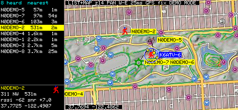
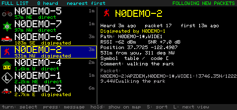
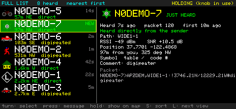
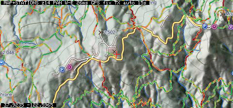
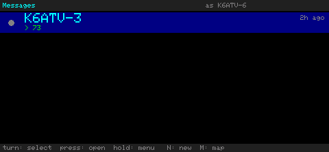
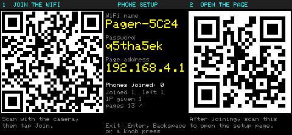
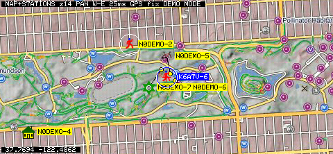

# pager-tracker

A LoRa APRS tracker, station map and messenger for the **LilyGO T-LoRa Pager (433 MHz)**, written from scratch.
It listens on 433.775 MHz, draws the stations it hears on a map from your own SD card, beacons your position, and sends and receives
APRS messages with acknowledgements, all on the pager's own screen, rotary knob and keyboard. Setup is done from a phone.

> **Status: alpha.** Working on a real pager, tested by its author on one unit only (the SX1262 version). Expect rough edges.
> **It transmits.** You need an amateur radio licence and your own call sign. The pager will not transmit until a call sign is saved.

*The screenshots with stations and with the full list show **demo data**: simulated stations (`N0DEMO-1` to `-8`) around Golden Gate Park, produced by the
firmware's demo mode (`DEMO MODE` is shown on the screen, and nothing is transmitted while it is on). The other pictures are real.*

## What it does

- **Map.** Reads the standard `<z>/<x>/<y>.png|jpg` raster tile layout from the SD card (the same layout the T-Deck LoRa APRS
  firmware uses, so one card works in both). Knob to pan and zoom, GPS position, centre on me. Decoded tiles are cached in PSRAM.
- **Heard stations.** Decodes LoRa APRS position packets (plain and compressed positions, objects), draws each station with its
  APRS symbol (24 px, including overlay letters), and keeps a list. Icons that would overlap are fanned out with a line to the true
  position, and the labels are stacked so none covers another. Your own symbol and call sign are drawn too.
- **Four views on the L key**, named in the top line: `LIST+MAP`, `MAP+STATIONS`, `MAP ONLY`, `FULL LIST`. The full list shows, for each
  station, how long ago it was heard, how many packets, whether it came directly or through a digipeater (and which), the path, RSSI and
  SNR, position, distance and bearing from you, its comment, and the complete packet text.
- **Beacon.** Sends your position with your chosen symbol and comment. Listens first (channel activity detection) and skips the beacon if
  the channel is busy. Auto-beaconing is **off at power-on** unless you switch that on in setup; moving it beacons about once a minute
  after 150 m, standing still every 10 minutes (all settable).
- **Messaging** (design in [docs/messaging.md](docs/messaging.md)). Conversations per call sign with unread badges, threads, compose with
  quick replies on the knob, acks and retries (30 s, then doubling, six tries), one open message per addressee, delete with undo,
  ASCII emoticons drawn as pictures on the screen (the text on the air stays plain ASCII), RSSI and SNR on received messages.
  Messages are kept in the pager's flash.
- **Setup from a phone.** Press Enter: the pager opens its own WiFi hotspot (random password, QR code on the screen) and serves a
  setup page at `http://192.168.4.1`: call sign, symbol (with a picker), comment, path, power, beacon intervals, haptics, brightness.
  The hotspot is off again when you leave the screen.
- **Haptic feedback** on knob clicks, new messages, acks and errors.
- **Screenshots over USB** for documentation (`tools/screenshot.py`).

The firmware only **reads** the SD card. Settings and messages live in the pager's own flash.

| | |
|---|---|
|  |  |
| FULL LIST view (demo data): everything about the selected station | A station that has just been heard lights up (demo data) |
|  |  |
| Terrain, grade-coloured trails and peak heights from your own map card | The conversation list |
|  |  |
| Phone setup: scan the left code to join the pager's hotspot, the right one to open the page | MAP+STATIONS view (demo data) |

## Controls

The rotary knob works everywhere on its own; the keyboard types text and gives shortcuts.

**Map**

| | |
|---|---|
| Knob turn / short press | move or zoom / change what turning does (pan W-E, pan N-S, stations, zoom) |
| Knob long press | centre the map on my GPS position |
| `L` | next view: LIST+MAP, MAP+STATIONS, MAP ONLY, FULL LIST |
| `S` | station list order: nearest first / most recent first |
| `M` | messages |
| `C` | centre on me |
| `T` | auto-beacon on / off (off at every power-on unless set in setup) |
| `B` | send one beacon now |
| `Backspace` | main menu: messages, phone setup, beacon now, auto-beacon, power off |
| `Enter` | phone setup |
| `P` | send a screenshot over USB (with `tools/screenshot.py`) |

**Main menu** (Backspace on the map): turn = move, press = choose, long press or Backspace = close.

**Full list view:** turn = select a station, press = write a message to it, long press = show it on the map.
**Messages:** `N` new message, turn = move, press = open / reply / send, long press = menu (reply, cancel retries, delete message,
delete conversation, delete all, undo), `Backspace` = back, `M` = back to the map. Typing: `Alt` held = digits and symbols, `Shift` = next letter capital.

## Power

- **Turn off:** Backspace, choose **Power off**, then **Yes, power off** (the menu starts on No). The pager stops the beacon, saves your
  messages, puts the radio to sleep and tells the battery charger chip (BQ25896) to disconnect the battery. It **refuses while USB is
  connected** ("Unplug USB first"): that is the chip's own rule. Tested on the author's pager: it switched off.
- **Turn on:** hold the **POWER** button for about a second (bottom edge: RST, BOOT, **POWER**, SD socket, USB-C), or plug in USB.
  It starts like any power-on: your settings and messages are kept, auto-beacon is off unless you set it to start on.
- RST restarts the application; BOOT with RST is download mode for flashing (see below). Neither switches the pager off.

## Hardware

ESP32-S3, 16 MB flash, 8 MB QSPI PSRAM; ST7796 480x222 colour display; **SX1262** radio (the unit it was developed on; an LR1121 version
exists and the bring-up test probes both, but the application drives the SX1262 only); MIA-M10Q GPS; TCA8418 keyboard; rotary encoder; DRV2605 haptic driver; BQ27220 fuel gauge;
XL9555 I/O expander that switches power to the radio, GPS, keyboard and SD and **must be initialised before them**; one SPI bus shared by the
display, SD card, radio and NFC. Pins are in `src/pins.h` and match LilyGoLib's pager variant.

Things worth knowing (all found on the real hardware):
- Keyboard: the `P` key arrives as raw code 97 and `Enter` as 98 (the chip reports the last column as GPIO-style events), and `Enter` also
  closes matrix key 20. The map is in `src/keymap.h`. The keyboard chip has been seen to stop reporting keys; the firmware now checks its
  setup once a second and re-programs it (cause not proven, suspected radio burst).
- The screen's bytes are swapped for 16-bit pixels in LovyanGFX; icon blending in `src/app/app.cpp` accounts for that.
- Opening the pager's USB serial port with DTR/RTS set resets the chip every time. `tools/screenshot.py` does not set them.

## Build and flash

    pio run -e app                          # the application
    pio run -e app -t upload --upload-port <PORT>

PlatformIO environments: `app` is the application, `pager` is the milestone-1 bring-up test,
`bench` / `bench_tdeck` are the read-only tile benchmarks (see [docs/benchmarks.md](docs/benchmarks.md)).

**Before the first flash, back up the factory firmware** (the LilyGO menu is replaced by this application):

    python esptool.py --chip esp32s3 --port <PORT> read_flash 0x0 0x1000000 pager-factory-16MB.bin

Restore with `write_flash 0x0 pager-factory-16MB.bin`. LilyGO also publishes factory images in
`Xinyuan-LilyGO/LilyGoLib/firmware`. **To flash, the pager must be in download mode:** hold BOOT, tap RST, release BOOT. After flashing,
press RST alone to start the new firmware.

First start: press Enter, join the pager's hotspot from your phone (scan the QR code), open `http://192.168.4.1` and save your call sign.
Until then the pager listens and shows the map but will not transmit.

## SD card

`/LoRa_Tracker/Maps/<REGION>/<z>/<x>/<y>.png` or `.jpg`, 256 px tiles on a FAT32 card (the T-Deck's 128 GB FAT32 card mounts
as SDHC and works). The first region folder found is used; zoom levels 6, 7, 8, 10, 12 and 14.
The tile files are made elsewhere (the terrain pipeline); this repository only reads them.

## Tests

The parsers and engines are plain C++ and are tested on a PC:

    for t in aprs geo settings messaging emoticons; do
      c++ -std=c++17 -I src test/host/test_$t.cpp -o /tmp/test_$t && /tmp/test_$t; done

They cover the APRS frame parser and beacon builder, GPS sentences, distance and bearing, the settings validation, the messaging engine
(including a message and its ack going through two engines), and the emoticon matcher.

## Layout

| | |
|---|---|
| `src/app/app.cpp` | the application: map, stations, beacon, setup hotspot, glue |
| `src/aprs.h`, `src/nmea.h`, `src/geo.h` | APRS frames, GPS sentences, distance / bearing (plain C++) |
| `src/messaging.h`, `src/msg_ui.h`, `src/emoticons.h` | messaging engine, its screens, emoticon matching |
| `src/settings_core.h`, `src/webui.h` | settings and their validation, the phone setup page |
| `src/beacon.h`, `src/haptic.h`, `src/inputs.h`, `src/keymap.h` | beacon timing, haptics, knob and keyboard |
| `src/symbols24.bin`, `src/emoji18.bin`, `src/web/` | icon data built by the scripts in `tools/` |
| `tools/` | icon builders, `screenshot.py`, `mockup/` (screenshot in a picture of the device), `count_vec.py` |
| `docs/messaging.md` | the messaging design and the reasoning behind it |
| `docs/benchmarks.md` | tile and vector measurements |

## Not done yet

Mic-E and other position formats are not decoded (those stations do not appear); bulletins, group text and meeting-spot objects are
designed but not built; the battery level is not shown on screen; the LilyGO menu cannot be kept alongside this application (it needs a
two-app flash layout); the tocall is the experimental `APZPGR` (a registered one is to be requested); vector maps are a later phase.

## Releases

The first release is **v0.1.0-alpha.1**, a testing release: it is meant for people who are comfortable building firmware and who hold an amateur radio licence.
Bug reports are welcome. Not done yet is listed above; the registered tocall (the pager currently transmits as the experimental `APZPGR`, see
`docs/tocall-request.md`) is one of the first things to change.

## Licence

The code is under the MIT licence (see `LICENSE`). The pictures and libraries below keep their own terms.

## Credits and licences of things in the firmware

These pictures are **not** covered by this project's own licence:
- **APRS symbols:** the aprs.fi symbol set by Heikki Hannikainen, OH7LZB (https://github.com/hessu/aprs-symbols), included here with this credit.
  Its licensing is mixed and partly unknown: most symbols are vectorised from the old APRS bitmaps whose designers and licence are unknown,
  some are CC BY-SA 2.0 or public domain, and a few are brand logos (Apple, Microsoft, Kenwood) that belong to those companies. Read its
  `COPYRIGHT.md`. If you are a rights holder and want a symbol removed, open an issue. Built into `src/symbols24.bin` and `src/web/sym*.png` by `tools/make_symbols.py` and `tools/make_symbol_sheets.py`.
- **Emoticon pictures:** Twemoji graphics, (c) Twitter, Inc and other contributors, CC-BY 4.0 (https://github.com/jdecked/twemoji,
  LICENSE-GRAPHICS), built into `src/emoji18.bin` by `tools/make_emoji.py`.

Libraries: LovyanGFX (display), RadioLib (radio), and the Arduino-ESP32 core; see each project for its licence. Pin numbers and the board's
start-up order were checked against LilyGO's LilyGoLib (MIT). The map tiles belong to whoever made them: credit them where they are shown.

## Prior art (searched 2026-11-22)

No existing LoRa APRS firmware for the Pager and no handheld that draws heard LoRa APRS stations on its own screen was found; that is
"none found", not proof of first. Nearest: Trail Mate (Pager, SD tile map, Meshtastic/MeshCore only), a T-Deck Plus tracker by 2E0LXY
(map planned, different frequency), dk8hc's T-Deck+ firmware (list only), and the CA2RXU tracker (no Pager, no map).
